# odesuite

A from-scratch ODE solver library in Python, and a desktop studio built on it. Adaptive
Runge–Kutta, stiff solvers, differential-algebraic systems, event location, boundary
value problems, parameter sensitivities, and two uncommon methods — an arbitrary-order
Taylor integrator built on automatic differentiation, and an exponential integrator for
stiff semilinear PDEs.

SciPy is used for LU factorisation, sparse storage and root-finding. **No integration is
delegated to it.** Every method here is implemented from the coefficients up, and its
correctness is established independently of SciPy — see [Verification](#verification).

```python
from odesuite import ODEProblem, solve, Event

prob = ODEProblem(f=vdp, t_span=(0, 3000), y0=[2.0, 0.0], jac=vdp_jac, args=(1000.0,))
sol  = solve(prob, method="radau", rtol=1e-8, atol=1e-10,
             dense_output=True, events=[Event(g, terminal=True, direction=-1)])

sol.y_at(1234.5)      # continuous solution, vectorised over t
sol.t_events[0]       # where g(t, y) = 0
sol.stats             # nfev / njev / nlu / steps / rejections / runtime
```

```
pip install -e ".[app]"     # then:
odesuite-gui
```

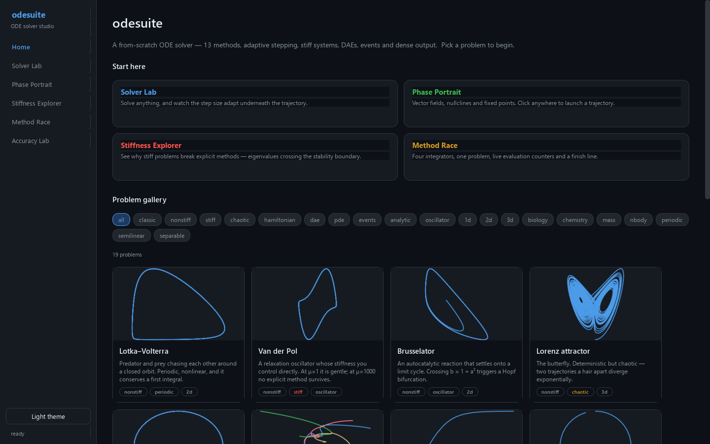

---

## Methods

| Method | Order | Kind | Notes |
|---|---|---|---|
| `rk23` | 3(2) | explicit RK | Bogacki–Shampine, FSAL |
| `rkf45` | 5(4) | explicit RK | Fehlberg, local extrapolation |
| `cashkarp` | 5(4) | explicit RK | Cash–Karp |
| `dopri5` / `rk45` | 5(4) | explicit RK | Dormand–Prince, FSAL, free 4th-order dense output — **default** |
| `tsit5` | 5(4) | explicit RK | Tsitouras, minimised leading error |
| `rodas4` | 4(3) | Rosenbrock | L-stable, stiffly accurate, solves index-1 DAEs |
| `radau` | 5(3) | implicit RK | Radau IIA, L-stable, stiffly accurate, collocation dense output |
| `radaudense` | 5(3) | implicit RK | Radau via the full 3n×3n solve — the oracle the fast path is tested against |
| `taylor{N}` | N | Taylor series | Arbitrary order via jet arithmetic; `taylor8/20/30` preregistered |
| `etdrk4` | 4 | exponential | For `u' = Lu + N(u)`; fixed step |
| `verlet` | 2 | symplectic | Störmer–Verlet; fixed step |
| `yoshida4/6/8` | 4/6/8 | symplectic | Composition of Verlet; fixed step |

Beyond the IVP solver: `solve_bvp` (multiple shooting), `forward_sensitivities`
(`dy/dp` by internal differentiation), mass matrices `M y' = f` including singular `M`
(index-1 DAEs), and event location to machine precision.

`solve` takes a `callback(t, y, stats)` called after every accepted step; returning
`False` stops it. One parameter, and it is the difference between a black box that
returns eventually and a solve you can watch, stream, plot live, or give up on — the
studio uses it to abandon a solve the moment a slider supersedes it, instead of holding a
worker thread to compute an answer nobody will read.

### Events that a step can hide

Comparing `g` at the two ends of a step misses any **even** number of crossings inside
it, silently — and the step size is chosen to resolve `y`, not `g`. On a smooth decay
with `g = sin(20t)`, 63 roots exist in the interval and endpoint comparison finds **5**,
with nothing to indicate the other 58 are missing.

```python
Event(g, subdivisions=16)     # sample inside each step, not just at its ends
```

finds all 63, each to 2e-14. It is off by default because an event that changes sign once
gains nothing from it. `scipy.integrate.solve_ivp` has no equivalent.

---

## Verification

Correctness evidence is the point of this project, so it is worth being specific about
what is actually checked. **2869 tests**, of which the load-bearing ones are:

**Order conditions, algebraically.** `tests/test_tableaux.py` evaluates the rooted-tree
order conditions through order 5 for every Butcher tableau, and asserts that the
conditions *fail* at order p+1 — so each declared order is neither overstated nor
understated. A single mistyped digit fails this instantly and exactly, rather than
surfacing later as a slightly wrong convergence slope.

**Order, numerically.** Local truncation error is measured with a geometric step sweep
that self-terminates at the round-off floor, and the slope is read from the finest valid
pair. Every method is held to its own theoretical order — the tests do not simply
reproduce SciPy's behaviour.

**Error estimators are checked directly.** `test_error_estimate_is_nondegenerate` exists
because a Rosenbrock pair transcribed into this library once had an embedded weight
vector that annihilated the stage vector exactly, giving an error estimate of ~1e-17 on
every problem. Every accuracy test still passed — the solution was fine — while the
adaptive controller was blind and accepting every step. That method was removed; the test
that catches it is permanent.

**Constants are derived, not transcribed, wherever possible.** Radau's eigendecomposition
comes from `numpy.linalg.eig` at import (and matches the published `MU_REAL`/`MU_COMPLEX`
to 1e-12); the symplectic composition weights come from the triple-jump recursion; the
stability functions below are measured by running the actual steppers.

**The step controller and the Newton iteration are tested directly**, not only through
the solves they drive. `tests/test_controllers.py` checks the PI and I formulas against
the arithmetic they document, the clamps, and the rule that a rejected step never
enters the PI history; `tests/test_newton.py` pins the termination test to the
*remaining geometric series* rather than the last correction, by constructing an
iteration that converges slowly enough for the two to disagree. Both modules used to
be covered only indirectly — which, given that the worst bug recorded below was a
controller running blind, was the wrong place to have a gap.

**Cross-validation** against `scipy.integrate.solve_ivp` on shared problems, used as an
oracle only — never as the basis of an order or accuracy claim.

```
py -3.10 -m pytest tests/ -q          # 2850 passed, 19 skipped, ~8 min
py -3.10 -m pytest tests/ -q -m 'not slow'   # the fast loop, ~3.5 min
py -3.10 -m ruff check . && py -3.10 -m mypy # lint and types, both clean
py -3.10 benchmarks/run_all.py        # regenerate every static figure below
```

The interface is tested too, headlessly, and not only for smoke: the phase-plane
analysis is checked against closed forms, the two independent routes to `R(z)` are
checked against each other, and the "copy as code" button's output is **executed** to
prove it runs.

---

## Results

### Stability regions

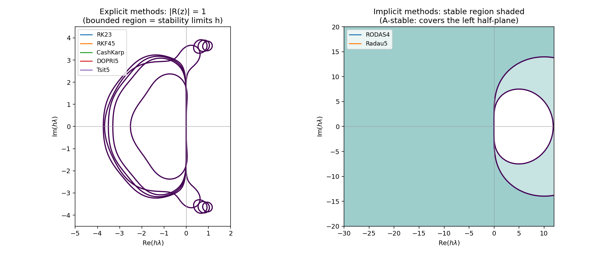

`R(z)` is measured by running each stepper for one step on `y' = λy` with `h = 1`, rather
than deriving a formula per method family. The measured classification matches theory:

| Method | Real-axis limit `\|hλ\|` | A-stable | L-stable | `\|R(-∞)\|` |
|---|---|---|---|---|
| rk23 | 2.52 | no | no | ∞ |
| dopri5 | 3.32 | no | no | ∞ |
| tsit5 | 3.53 | no | no | ∞ |
| cashkarp | 3.76 | no | no | ∞ |
| **rodas4** | ∞ | **yes** | **yes** | 8.8e-10 |
| **radau** | ∞ | **yes** | **yes** | 3.0e-10 |

The bounded region for explicit methods *is* the stiffness restriction: on Robertson,
`dopri5` reaches only `t = 54` out of `1e11` after 50 000 steps.

### Work-precision

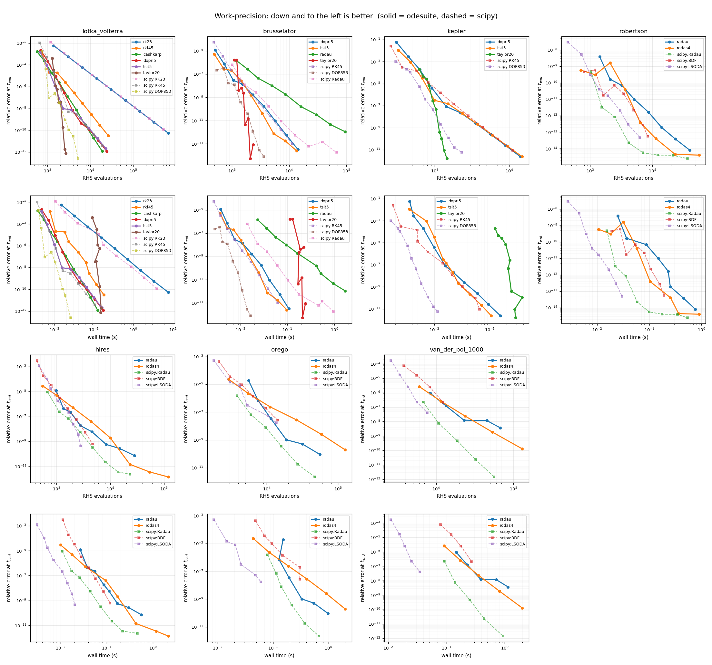

Relative error at the endpoint against RHS evaluations and against wall time, sweeping
tolerance over eight decades. Selected results at the tightest tolerance:

| Problem | Method | error | nfev |
|---|---|---|---|
| Lotka–Volterra | **taylor20** | **7.7e-13** | **2 682** |
| | scipy DOP853 | 2.5e-13 | 5 162 |
| | dopri5 | 1.2e-12 | 24 086 |
| Kepler (e=0.5) | **taylor20** | **1.5e-12** | **1 462** |
| | scipy DOP853 | 5.7e-12 | 2 318 |
| Robertson | radau | 8.1e-15 | 40 026 |
| | scipy Radau | 2.4e-15 | 37 112 |
| HIRES | radau | 7.3e-11 | 28 320 |
| | scipy Radau | 2.3e-12 | 23 136 |

Read honestly: **the Taylor method is the standout**, reaching higher accuracy than
SciPy's best explicit integrator with roughly half the evaluations on smooth problems.
The explicit RK pairs are competitive with SciPy's (within ~1.3× on evaluations).
`radau` uses **1.08–1.22× SciPy's Radau evaluations and 1.2–1.5× its wall time** across
the four stiff problems — closed up from 1.3–1.5× and ~1.7× by the predictive step
controller described under [Design](#design). SciPy's `LSODA` and `BDF` are faster
still on stiff problems; they are BDF-based, a family deliberately excluded here (see
[Scope](#scope)). `rodas4` needs 1.4–4× `radau`'s work, as expected: it recomputes the
Jacobian every step and is an order lower.

The numbers behind this figure are written to `figures/work_precision.json` alongside
it, so a change in performance is a diff rather than something noticed by eye. One
caveat on method: three timing repeats stabilise the numbers *within* a run and not
*across* runs — two sweeps minutes apart on the same machine were seen to differ by
30–60% in the same direction. Comparing two versions of the code means interleaving
them in one process, not running one, editing, and running the other.

### Symplectic energy drift

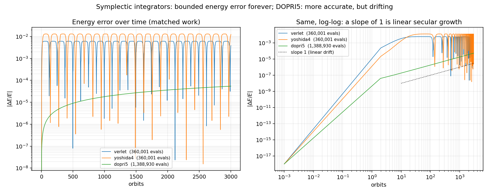

Kepler at e=0.3 for 3000 orbits, at matched work. The diagnostic is the worst energy
error in the second half of the run divided by the worst in the first half:

| Method | nfev | 1st-half max | 2nd-half max | ratio |
|---|---|---|---|---|
| verlet | 360 001 | 6.03e-03 | 6.03e-03 | **1.00** — bounded |
| yoshida4 | 360 001 | 1.30e-02 | 1.30e-02 | **1.00** — bounded |
| dopri5 | 1 388 930 | 2.70e-05 | 5.41e-05 | **2.00** — linear growth |

DOPRI5 is far more accurate in absolute terms and stays so for a long time — but its
energy error *doubles as the interval doubles*, while the symplectic methods' error is a
bounded oscillation, the same size after three thousand orbits as after ten. Accuracy and
qualitative fidelity are different properties.

### Exponential integrator on a stiff PDE

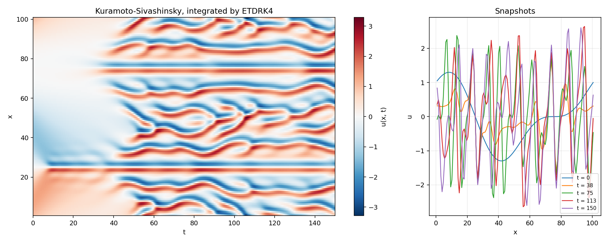

Kuramoto–Sivashinsky, `u_t = -u_xx - u_xxxx - u u_x`, spectrally discretised. At 256 modes
`|L|max ≈ 4032`, so an explicit method is stability-bound at `h < 5e-4`:

| Method | steps | nfev | error | time |
|---|---|---|---|---|
| **etdrk4** | **1 001** | 4 005 | 9.5e-09 | **76 ms** |
| etdrk4 | 2 000 | 8 001 | 8.0e-10 | 153 ms |
| dopri5 | 24 384 | 146 318 | 2.6e-11 | 4 085 ms |
| tsit5 | 22 991 | 137 960 | 3.0e-11 | 4 484 ms |

**24× fewer steps, 54× faster.** ETDRK4 treats `exp(hL)` exactly, so the stiffness of the
linear part imposes no step restriction at all.

---

## The studio

A PySide6 desktop application over the same library — `odesuite-gui`, or
`python -m odesuite_app`. Dark and light themes, everything solved on a worker thread so
the interface never blocks.

It has two sections over a shared home, because it serves two audiences.

**Solver Studio** is the original one, and its guiding idea is to show **what the solver
is doing**, not just the answer: the step-size timeline, the stability regions, the
work-precision sweeps. That is what a generic plotting front-end cannot do, and what this
library has the data for. It aims at someone learning *numerical methods*.

**Learning Hub** aims at someone taking a *first ODE course*, which is a different
subject: separable equations, integrating factors, characteristic roots, Laplace
transforms, and modelling. It shows technique rather than answers — see
[Learning Hub](#learning-hub) below.

The split is presentation only. Both sections drive the same session and select from the
same catalogue by key, which is what lets an equation you typed appear on either side.

### Solver Lab

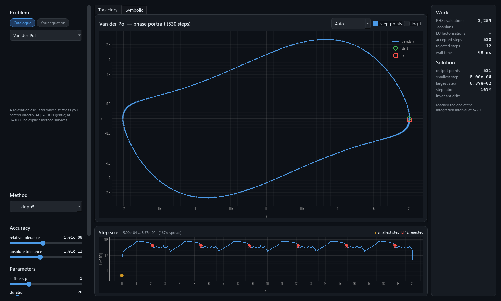

Problem and method pickers, live tolerance and parameter sliders, work counters — and
the **step-size timeline** underneath, which is the signature view. On Robertson it
spans 1.3e+14×, with the 11 rejected attempts marked in red exactly where the controller
misjudged the problem. Trajectories are drawn from the **dense output**, so a 73-step
Taylor solve of a Kepler orbit renders as a smooth ellipse rather than a polygon.

### Phase Portrait Studio

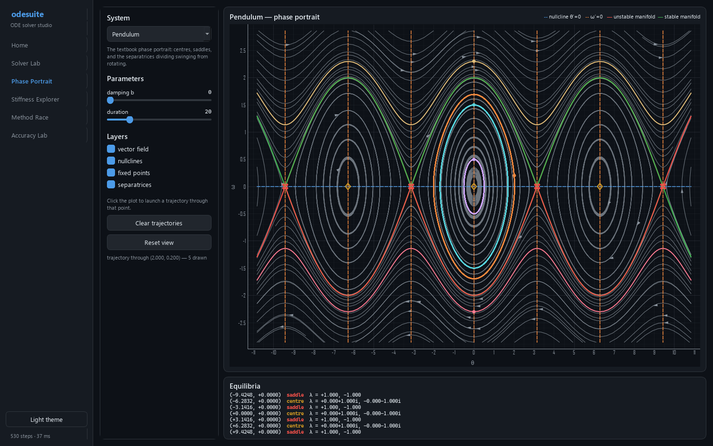

Streamlines, nullclines, equilibria classified by the Jacobian's eigenvalues, and the
separatrices out of every saddle. Click anywhere to launch a trajectory — integrated
forwards *and* backwards, which is what makes it the curve *through* a point. Parameter
sliders recompute the whole analysis, so a pitchfork bifurcation happens as you drag.

Everything here is checked against closed forms in `tests/test_analysis.py`: the
pendulum's separatrix is verified to lie on the energy level **E = 1** to 1e-6 across all
700 sampled points.

### Stiffness Explorer

| explicit | implicit |
|---|---|
| 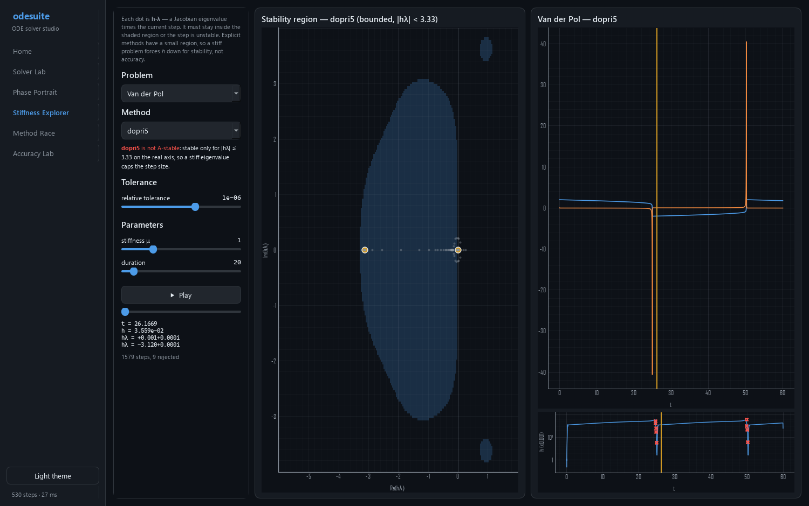 | 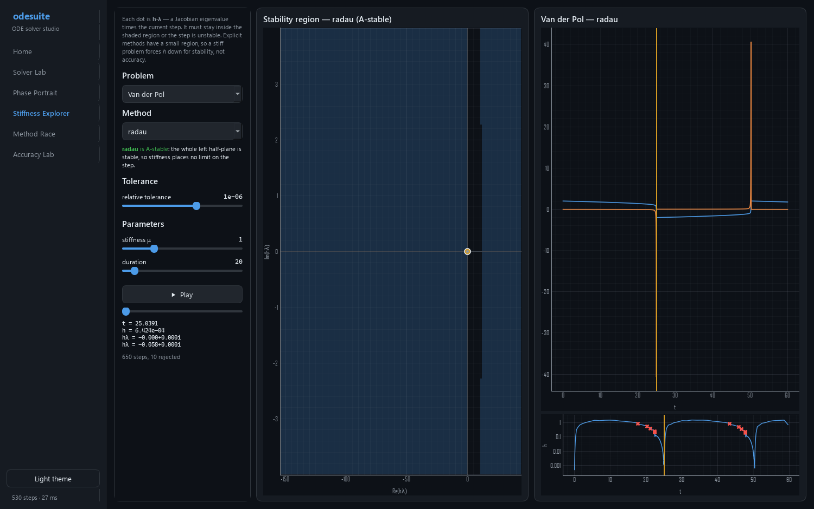 |

The clearest argument in the project. Left panel: the method's stability region. Right:
the solve. As it plays, the Jacobian's eigenvalues scaled by the current step, `h·λ`, move
across the complex plane.

On Van der Pol at μ=30, DOPRI5's readout shows `hλ = −3.120` against a boundary at
**3.33** — the step is pinned by *stability*, not accuracy, and 1579 steps are needed.
Switch to Radau: the whole left half-plane turns stable, `h·λ` roams out to −150, and the
same solve takes 650 steps.

### Method Race and Accuracy Lab

| 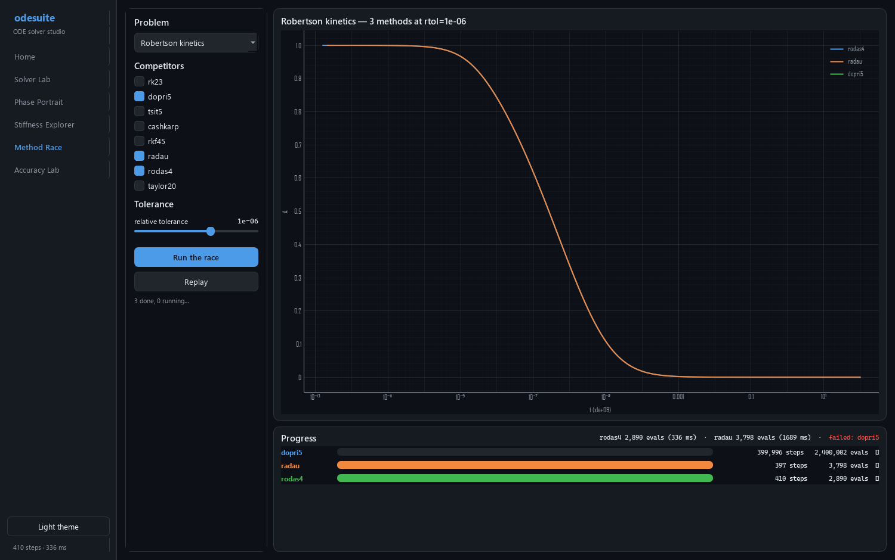 | 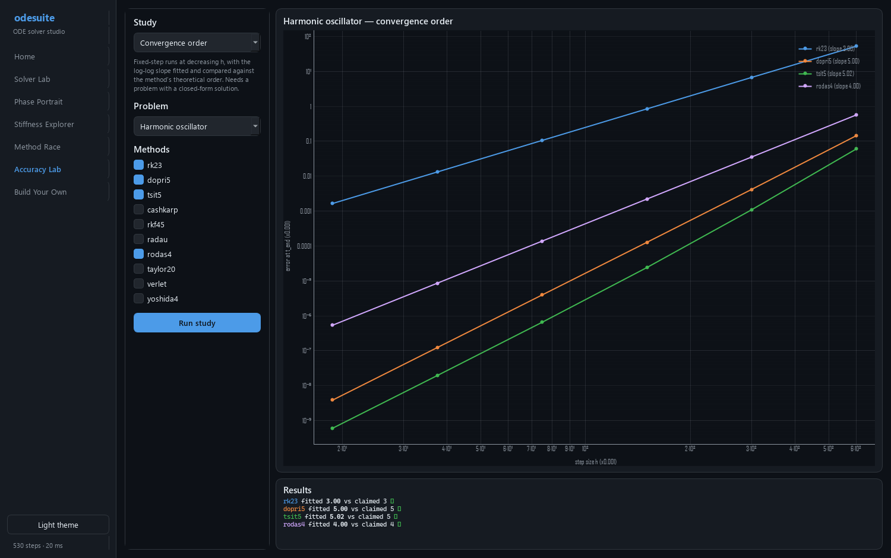 |
|---|---|

The race replays several methods against integration time with live counters. On
Robertson, Radau and RODAS4 finish in 397 and 410 steps while DOPRI5 burns **399,996 and
fails** — the Phase 2 acceptance result as a spectator sport.

The Accuracy Lab runs the verification harness interactively: work-precision sweeps,
energy drift, and convergence-order fitting. The screenshot shows four methods fitted at
**3.00, 5.00, 5.02 and 4.00** against claims of 3, 5, 5 and 4.

### Your own equation

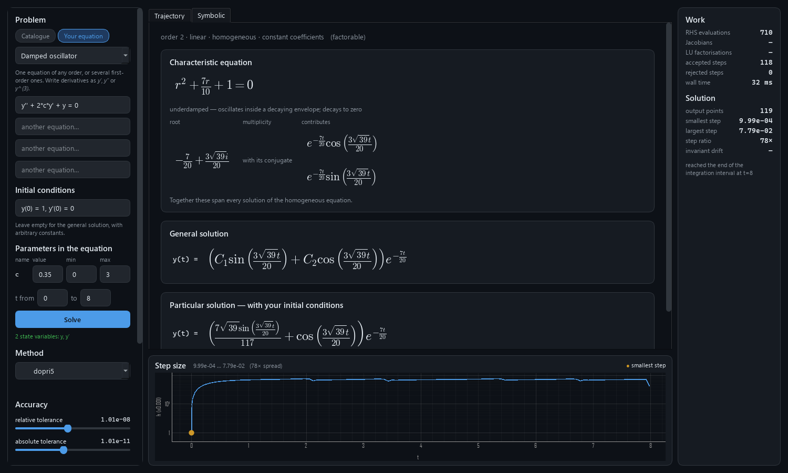

The Solver Lab takes a typed equation as readily as a built-in problem — one equation of
any order, `y'' - mu*(1 - y**2)*y' + y = 0`, or several first-order ones. sympy parses it
and **differentiates it symbolically**, so a hand-written right-hand side reaches the
solver with an exact Jacobian and every implicit method works on it.

It is registered as an ordinary catalogue entry, which is what makes it go further than
its own screen: the phase portrait, the stiffness explorer and the method race select
problems by key and cannot tell the difference, so **an equation you typed can be raced
against seven methods** or swept for stiffness with nothing added to those screens.

Alongside the trajectory there is the **closed form**, where one exists: the
characteristic polynomial, its roots and multiplicities, the `e^{rt}` / `t·e^{rt}` /
`e^{at}cos bt` each contributes, the general and particular solutions typeset, and a
verification that substituting the answer back into the equation gives *exactly* zero.
Give a coefficient a slider and the roots follow it live — drag `c` in
`y'' + 2c·y' + y = 0` and watch the complex pair collide at `c = 1` and split onto the
real axis: underdamped, critically damped, overdamped.

Two limits are enforced rather than glossed. `dsolve` does not merely stall on some
equations, it **hangs** — `y' = sin(y)` never returns — so it runs in a subprocess under
a hard timeout. And a **static vector field is only meaningful for an autonomous
system**: a forced equation is kept out of the phase portrait instead of being drawn
against a field it does not obey.

Parsing is locked down. `sympy.sympify` *evaluates* its input with the ordinary builtins
in scope, so `sympify("__import__('os').system(...)")` runs the command — a hole this
project had until a test caught it. Expressions now go through `parse_expr` with an
explicitly emptied `__builtins__` (explicitly, because an absent key makes Python
reinstate the real one) and a whitelist of elementary functions.

### Learning Hub

A first ODE course is not about adaptive step control. It is about knowing that
`y'' + 3y' + 2y = 0` is solved by characteristic roots and being able to carry that out.
The Studio shows answers; this section shows **technique**.

**Course Map** is the view from above: four units, the lessons inside each, how far
through you are, and a *Continue* button that opens the earliest lesson with a question
left. A unit appears there once it has lessons — there is no placeholder for one still to
be written.

**Lessons** is where the work happens. One lesson at a time, in four parts: **Learn**
(what you should be able to do afterwards, why the topic exists, where the method comes
from, then the notes), **Examples** (each worked through by the narrator, on request,
with prose saying what to watch), **Practice** (your turn), and **Drill** (below).
Thirty-five lessons today, filed under the chapters of Edwards, Penney and Calvis, which
is the course this follows:

- **First-order equations** — what a differential equation is; slope fields, existence
  and uniqueness; separable equations; integrating factors; exact equations;
  substitutions (homogeneous and Bernoulli).
- **Models and numerical methods** — population models and the logistic equation;
  equilibria, stability and the phase line; acceleration, velocity and drag; Euler's
  method; Runge–Kutta, and what order buys.
- **Second-order linear equations** — superposition and the Wronskian; characteristic
  roots; undetermined coefficients; variation of parameters; Cauchy–Euler; higher-order
  equations.
- **Vibrations and forcing** — free vibration and the three damping regimes; forced
  oscillation, beats and resonance; the RLC circuit analogy.
- **Laplace transforms** — the transform and reading the table; solving an
  initial-value problem; shifting theorems and partial fractions; convolution; step
  functions and piecewise forcing; impulses and the delta function.

- **Linear systems** — first-order systems and how everything becomes one; the
  eigenvalue method with real distinct eigenvalues; complex eigenvalues; repeated
  eigenvalues and defective matrices; nonhomogeneous systems and the matrix
  exponential; phase portraits.

- **Series solutions** — power series and ordinary points; recurrence relations and the
  radius of convergence; regular singular points, and what Frobenius is for.

All seven units are complete: the whole of a first course, from what a differential
equation is to what to do when it has no closed form.

**The first unit is written up as a textbook section, and the rest are not yet.** The
difference is measurable and worth stating plainly: a rewritten lesson carries about
5,500 characters of explanation, against 1,500 for one still in its original form. What
the extra buys is three things a card full of facts cannot.

*Why this comes up*, before any technique is named — where the equation arises, what
goes wrong with the tools already in hand, and why this method is the natural response.
A lesson that opens with "here is a technique" has skipped the only part a reader cannot
reconstruct alone.

*Where this comes from* — the argument that the method is legitimate, in numbered steps,
with the step everyone waves at made explicit. Separable equations justify
`∫dy/g(y) = ∫f dt` by the chain rule on `H(y(t))` rather than calling the `dy` loose
shorthand; the integrating factor is *derived* from `(μy)' = μy' + μ'y` rather than
produced; exactness is shown to be the symmetry of mixed second partials rather than a
test to remember. This is deliberately not the same thing as the worked examples: the
narrator shows the moves for one equation, and no number of those adds up to why the
moves are allowed.

*Commentary on each worked example* — which line is the one that matters, what would
have gone wrong a step earlier, what the shape of the answer is telling you. The
narrator supplies the steps and cannot supply the reading of them.

The remaining six units are the same work and no new machinery: `tests/test_lessons.py`
holds the list of lessons written up so far, so what is left is visible in the tests
rather than in a plan.

Notes come in kinds, and a **common mistake** does not read like an idea: it is the same
card with a warning stripe down it, because the thing that catches people is worth
setting apart from the thing that is merely true. Reading `p` straight off `t·y' + y = t`
is one; forgetting the factor of `t` on a repeated root is another.

**Six lessons have a figure you can move**, at the top of *Learn*. A note can say
that raising the harvest rate eventually wipes out both equilibria; a figure lets you
raise it and watch the two dots slide together and vanish, which is a different kind of
knowing.

- **Slope fields** draws the dashes `y' = a·y + b·t` demands at each point — no solving
  involved — and integrates a solution through anywhere you click. The curve comes out
  tangent to every dash it passes, and two curves never cross, which is uniqueness shown
  rather than stated.
- **Equilibria** plots `f(y)` for the harvested logistic equation `y' = r·y(1 − y/K) − h`,
  marks each equilibrium filled or hollow by which way the arrows point, and puts an
  arrow in each interval between them. Push `h` past `r·K/4` and both equilibria are
  gone.
- **Euler's method** runs Euler and RK4 on `y' = y`, whose answer nobody has to take on
  trust, and reports both endpoint errors against `eᵗ`. Halving `h` roughly halves
  Euler's error and cuts RK4's by about sixteen — and the ratios are printed as
  measured, not as theory: 1.8 and 14.7 at `h = 0.2`, climbing towards 2 and 16 as `h`
  shrinks. That limit is what *order* claims, and watching it approached says more than
  either number arriving exactly.
- **Damping** puts the characteristic roots of `m x'' + c x' + k x = 0` beside the
  motion they produce. Drag `c` and a complex pair slides together, meets on the real
  axis at `2√(mk)`, and separates — and the curve alongside stops crossing zero at the
  same moment. The regime is named by the same `symbolic.describe_roots` the Studio's
  root table uses. A slider quantises to 1000 steps and so can essentially never land on
  a single point of a continuum, which left the middle regime unreachable; the damping
  now snaps to critical within half a step, so the number shown is the number used.
- **Resonance** drives an undamped oscillator at `ω` from rest. Off resonance the
  response is a difference of cosines — a fast oscillation inside a slow envelope — and
  as `ω` approaches `ω₀` the envelope stretches and grows: measured, the amplitude runs
  0.69 at `ω = 1.6`, 2.56 at 1.9 and **25.1 at 1.99**. At `ω = ω₀` exactly there is no
  dividing by zero to do, because the closed form is the secular `t·sin(ω₀t)/(2ω₀)` and
  the envelope becomes a straight line. Beside it, what damping does to the same story:
  the blow-up becomes a peak, lower and further left the more damping there is.

- **Eigendirections** draws the vector field of `x′ = Ax` for a 2×2 matrix you change
  entry by entry, with the eigenvectors drawn on as the only straight-line
  trajectories and an arrow showing which way the flow runs along each. Move an entry
  until the two lines collide and they vanish — past that the eigenvalues are complex
  and nothing travels in a straight line. The origin is named by `systems.classify`,
  the same function the narrator ends its derivation with, so the picture and the
  working cannot disagree.

None of them computes any mathematics of its own. The dashes come from
`analysis.slope_field`, the equilibria from `analysis.phase_line`, the steps from
`byhand.walk` and `byhand.refinement`, and the curves from the library's own `solve` —
so a figure cannot disagree with the tool that teaches the same thing.

`analysis.phase_line` is the one piece of mathematics this needed, and it is not
`find_fixed_points` with an axis thrown away: that routine classifies a planar
equilibrium by the eigenvalues of a 2×2 Jacobian, and a scalar equation has no such
thing. It has something better — on a line, the sign of `f` on either side settles which
way solutions move, which is what a course draws and what stays right where the
linearisation says nothing. `y' = y²` is the case that makes the difference: `f'(0) = 0`,
so the derivative test calls it neutral and loses both arrows, while the signs correctly
call it semi-stable. Equilibria are found by refining every local minimum of `|f|` rather
than only the sign changes, for the same reason — a root the curve touches without
crossing has no sign change to bracket.

Hints come **one rung at a time** — a nudge, then the first move, then the next — and
"Show me", the real narrator, sits at the end of the ladder. A hint that hands over the
whole method on the first press is not a hint.

**Drill** is practice that does not run out. Each drill is a question with its numbers
left open — `y' + a·y = b·t` with `a`, `b` and the initial value drawn from a fixed set —
so it can ask the same *method* in eleven to forty-eight different versions. Three right
in a row and it is mastered; one wrong answer starts the count again.

The design is one sentence: **a generated question is an ordinary practice question.**
`draw(template, seed)` returns the same `Solve` type the hand-written questions use, so
it is graded by the same substitution, hinted by the same ladder, and worked by the same
narrator — the drill contributes no mathematics of its own and cannot disagree with the
rest of the Hub about what is correct.

**Some drills are generated multiple choice**, and they exist because grading, not
effort, was what left fifteen lessons without one. A typed answer is graded by
substituting it into its own equation — which cannot decide a switched or impulsive
answer, has nothing to substitute for Euler's method, and marks a truncated series
wrong. Those lessons do not need a `Solve` drill written; they need a question type
graded some other way, and `Choice` already is one. `ChoiceTemplate` is to `Choice` what
`Template` is to `Solve`.

**The options are shuffled per draw**, deterministically from the template's key and the
draw index, and each reason moves with its own option. Leaving the answer where the
author wrote it would put it at the same index in every version, so the drill would
teach the *position* — the exact failure a generated question exists to avoid. That the
answer moves, and that a reason never drifts onto a neighbouring option, are both tests.

With them the series unit can be examined at all: it had no drills, so it offered no
check-up, and a unit you cannot examine is one you cannot tell you have finished. All
seven units now offer one.

Draws are **enumerated rather than sampled**, which is what makes the guarantee
checkable: `tests/test_templates.py` runs the real narrator over **every draw of every
template a narrator solves** — 476 of them — and requires each to be narrated by the
technique the drill claims to be practice at, to have every step verify, and to have its
answer accepted by the grader. The 54 generated multiple-choice draws are swept the way
*they* can be checked: every option filled, every reason paired with its own option, and
the grader accepting the drawn answer and no other. Nobody wrote those questions, so nobody read them either; that sweep is what
stands in for having read them. It is also why the drill can honestly say "one of 18
versions", and why pressing Check cannot change the question under you.

Drills are counted separately from the practice questions, because the two numbers mean
different things: one is out of a fixed denominator, and the other is a streak that can
go back down.

The practice is graded by mathematics rather than by an answer key. A typed solution is
substituted into the equation and simplified, through the same check the tools use, so
`3*sin(3t)/3` and `-sin(-3t)` and `sin(3t)` are all one answer and none of them is marked
wrong for being spelled unexpectedly. Where sympy cannot decide, the verdict says so
rather than guessing.

**Where a typed answer cannot be graded, the drill is multiple choice instead.**
Substituting a switched or impulsive answer back leaves `Heaviside` and `δ` terms that
never cancel, so the verdict is *cannot tell* — correct, and useless as a drill, because
a verdict that can never be "right" can never advance a streak. That is a reason to
change the question type, not to omit the drill, which is what `ChoiceTemplate` is for.
Convolution still has none: its integrals cost seconds apiece, and the exhaustive sweep
runs every draw of every template.

Multiple-choice questions exist for the thing that check cannot reach — *which technique
solves this* is what a course actually tests, and a substitution check has nothing to say
about it. Those carry a stored answer, and each one carries a reason **for every option**,
shown for whichever you picked. The reason a wrong option was tempting is usually the
thing that was actually misunderstood, and explaining the right answer back at someone who
did not choose it teaches nothing.

The worked examples are **generated by the same narrator that powers Solve Step by Step**,
not transcribed, so a lesson cannot drift out of step with the tool that explains it — and
`tests/test_lessons.py` runs the real narrator over every example and every question to
prove each one has an answer the app can actually produce. Every example, not merely the
first: the one nobody checked is the one that rots.

**Progress can be taken with you.** *Export* writes everything answered to a file, and
*Import* merges one back in — merges, not replaces, because importing a file from a
machine where you had done less would otherwise delete work, which is the exact failure
the feature exists to prevent. Where both files know a question the stronger record
wins: more correct answers, then the longer streak, then the later date. The exported
file *is* a progress file, so there is no second format to keep in step and it can be
copied into place by hand.

**The Course Map also says what has gone quiet.** "Worth another look" ranks by score,
which can never surface a lesson finished in July and untouched since — it scores
perfectly. So a second line asks the other question: what has not been seen in three
weeks. Deliberately not a spacing schedule; this application records one verdict per
question and nothing about how hard each felt, so fitting an interval curve to it would
be inventing data. *You have not looked at this in three weeks* is a claim the file
actually supports.

**The window reopens where you left it** — size, position, and the screen you were on —
kept in `QSettings` rather than the progress file. That is preference, not achievement: a
geometry has no business in a file you may export to a machine with a different screen.
An explicit `--screen` or `--problem` still wins.

Progress is remembered between sessions in a small JSON file in your config directory,
with a reset button beside it. It is the only thing this application stores on disk. It
records how many times a question was attempted as well as how it ended, so the map can
tell steady work from a lucky guess — and a file written by an earlier version still
loads, with its ticks intact.

**Systems are narrated too**, by a different route. `classify_ode` has nothing to say
about a system, so the technique is not chosen from a hint list but from the shape of
the equations: `systems.derive` writes the pair as `x′ = Ax`, forms `det(A − λI) = 0`,
finds an eigenvector for each eigenvalue, and branches into the three cases a course
spends its time on. **Real distinct** eigenvalues give exponentials along fixed
directions. A **complex pair** is taken apart with Euler's formula applied to the
eigenvector as well as the exponential — the step people get wrong, so it is shown in
full rather than quoted. A **defective** matrix gets a generalised eigenvector from
`(A − λI)w = v`, and the `t` in `(vt + w)e^{λt}` is there to cancel a leftover term
rather than by convention.

**Forcing is handled by varying the constants**, with the basis solutions as the columns
of a fundamental matrix: `x_p = Φ ∫ Φ⁻¹f dt`. It is variation of parameters with the
bookkeeping done by a matrix, and it never needs the resonance correction that guessing
a form would. `e^{At}` is shown for what it is — the fundamental matrix normalised so
that `x(t) = e^{At}x(0)`, which is the same shape as the scalar `e^{at}y(0)`.

Everything is checked: the matrix and the forcing are reconstructed into the equations
they came from, the characteristic polynomial is expanded back, every eigenvector goes
through `Av = λv`, and every basis solution is substituted into the **homogeneous**
system — checking it against a forced one would report a correct fundamental set as
wrong.

**A system's answer is analysed and verified like any other.** Its characteristic
polynomial is `det(A − λI)` — the same object under another name, whose roots are the
eigenvalues — and the closed form is substituted back with every component going into
every equation at once. Both used to be skipped, which left the Studio showing a
system's root table blank and its answer unchecked.

**Check your answer works on systems as well**, component by component. A system's
answer is several functions, so it is typed as several lines — `x = ...` on one and
`y = ...` on the next — and each is substituted into *every* equation. That last part
matters: a pair can satisfy the first equation and fail the second, and checking them
one at a time would miss it. Each line names its unknown rather than being read by
position, because guessing the order would mark a correct answer wrong for anyone who
wrote them the other way round.

**Power series** are narrated too, and the thing narrated is the **recurrence**. sympy
will produce a truncated series — `dsolve(hint="2nd_power_series_ordinary")` does it in
about a quarter of a second — but it returns the truncation and not the rule that
generated it, and the rule is what is worth knowing. Building it here by matching the
coefficient of each power costs 0.01–0.02 s and gives the numbers a textbook prints:
Airy comes out `a₂ = 0`, `a₃ = a₀/6`, `a₄ = a₁/12`, `a₅ = 0`, `a₆ = a₀/180`, and the
pattern of every third coefficient vanishing is visible in the rule where the terms
alone only hint at it.

**A truncated series does not substitute to zero, and the derivation says so.** Putting
`C₁(1 − t²/2 + t⁴/24) + C₂(t − t³/6)` into `y'' + y` leaves `t³(C₁t − 4C₂)/24` — the
truncation error, which is the correct residual rather than a mistake. So `verified` is
decided by the residual being of high enough order, and the check is reported as
`truncation` rather than as substitution. Where the series **terminates** — Legendre's
and Hermite's equations at the right parameter — the residual really is zero, the
ordinary check is used, and the answer is reported as exact. A reader is entitled to
know which of the two claims was made.

**Solve Step by Step** narrates the derivation. Nine techniques — separation of
variables, integrating factors, exact equations, the homogeneous substitution `y = v·t`,
Bernoulli, characteristic roots, undetermined coefficients, variation of parameters,
Cauchy–Euler — written out a move at a time, with the reason each move is legal.

Every step is **checked, not merely printed**. The antiderivatives are differentiated
back and compared with their integrands; each basis function is substituted into the
equation and required to give exactly zero; the particular solution has to reproduce the
forcing term. A tick on a card means that card's claim was verified symbolically, and a
step that fails is shown failing rather than hidden — a derivation that quietly prints a
wrong line is the one thing worse than no derivation.

Getting this to dispatch at all turned on a measurement. `sympy.classify_ode` returns its
hints ordered by what sympy would rather *solve* with, which is not the order a course
*teaches*:

| equation | sympy's first hint | what a course calls it |
|---|---|---|
| `T' = -k(T - 20)` | `factorable` | separable |
| `y' + 2y = t` | `1st_exact` | integrating factor |
| `y'' + 3y' + 2y = 0` | `factorable` | characteristic roots |
| `t²y'' + ty' - y = 0` | `factorable` | Cauchy–Euler |

Taking the first hint — which the app did — would have left four of the five techniques
then implemented never selected. The whole tuple is read and the teaching name preferred,
which also fixed the Studio's label: `y'' + 3y' + 2y = 0` no longer reads "factorable",
which is true and useless.

**Exactness is the one thing not taken from a hint at all.** Six exact equations were
split into `M dt + N dy` and tested by hand against `∂M/∂y = ∂N/∂t`:

| equation | the test | `classify_ode` |
|---|---|---|
| `y' = −(2t+y)/(t+3y²)` | exact | `1st_power_series`, `lie_group` |
| `y' = −(2ty+1)/(t²+4y³)` | exact | `1st_power_series`, `lie_group` |
| `y' = −(cos t + y)/(t+2y)` | exact | `factorable`, `1st_power_series`, `lie_group` |
| `y' = −(3t²+2y)/(2t+1)` | exact | `1st_exact`, `1st_linear`, … |
| `y' = −(2t+3y)/(3t+4y)` | exact | `1st_homogeneous_coeff_best`, … |
| `y' = −y/t²` | **not** exact | `separable`, **`1st_exact`**, … |

sympy misses it on exactly the three equations an exact-equations lesson is *about*, and
offers it on one the test says is not exact — it normalises `M` and `N` differently, so
neither half of that is a sympy bug. It does mean the hint cannot be trusted, so
exactness is decided here, by the test a course teaches, and the detector is consulted
only where no named technique applies. An equation that is both exact and linear keeps
the integrating factor, which is the method it is met by first.

**Variation of parameters is reached only where guessing has nothing to offer**, and the
ordering that arranges is measured rather than assumed. sympy names
`..._variation_of_parameters` on *every* constant-coefficient forced equation — `y'' + 4y
= sin t` and `y'' + 3y' + 2y = eᵗ` included — so listing it before undetermined
coefficients would narrate Wronskians for every equation a first course solves by
guessing a form. Listed after, it takes only the equations where sympy names it alone:
`sec t`, `tan t`, `eᵗ/t`, whose derivatives never close into a finite trial set. It is
written for order *n* rather than the usual two, because the 2×2 formulas are Cramer's
rule on that system anyway — `y''' + y' = tan t` is narrated by the same builder, in
0.09 s.

The same builder repaired a defect worth naming. A **forced Cauchy–Euler produced an
empty derivation**: `t²y'' + ty' − y = t³` substituted `y = tʳ` into `lhs − rhs` with the
forcing still in it, so `t` survived the division and the builder gave up before
appending a single step. The forcing now comes off first and the Euler basis is handed to
variation of parameters — guessing has no theory behind it once the coefficients stop
being constant — giving `C₁/t + C₂t + t³/8`, verified.

The two substitutions **reuse** the separable and integrating-factor narrators rather
than copying them: `_bernoulli` builds a real equation in a real `v` and hands it over,
then undoes the substitution and applies the initial condition once, to the answer in
`y`. That is why those two narrators take the letter to print — a derivation that called
`v` "y" while solving for `v` would misreport what it had just done.

Because the derivation is computed independently of `dsolve` and published *before* it,
the two can disagree usefully. `y' = sin(y)` is the equation `dsolve` hangs on outright —
and separation of variables solves it in about five seconds. The worker writes the
derivation to its output before starting `dsolve`, so when the hard timeout kills the
process the parent reads a complete, verified solution back out of what it left behind.
The Hub shows the working where the Studio can only report a timeout.

Where a technique was found *without* a hint, `dsolve` is not asked at all. On
`y' = −(2t+y)/(t+3y²)` — a plain exact equation — it runs past forty seconds trying
`lie_group`, so the entire twelve-second budget buys a timeout; meanwhile the narrated
answer has already been substituted back and simplified to zero, which is a stronger
warrant than `dsolve` returning would have been. The guard is deliberately narrow: where
the hint list does name the technique, sympy knows it too and is asked as usual.

Alongside it, **check your answer**: type your own `y(t)` and it is substituted into your
equation and simplified. Equivalent forms pass, because the check never compares against
sympy's spelling; initial conditions are judged separately from the equation; and "cannot
decide" is reported as such rather than as "wrong".

**Laplace Transforms** is the one technique here that turns the equation into
*algebra*, and the only one that copes with forcing switched on partway through or
delivered as an impulse. `y' + y = u(t-2)` — a switch thrown at two seconds — is not
separable, has no integrating factor worth writing, and is not what undetermined
coefficients is for. It is three lines here, and the answer is the textbook
`u(t-2)(1 - e^{-(t-2)})`.

The initial conditions are the point. They do not arrive at the end as constants to be
pinned down; they enter at the start, through `L{y''} = s²Y - s·y(0) - y'(0)`, and the
narration shows them appearing there. A transform table sits alongside with the rows this
particular answer needed highlighted, so it reads as a reference being consulted rather
than as decoration.

Two obstacles were worth the trouble of handling properly rather than hiding. `apart`
raises `PolynomialError` on an `e^{-as}` factor — on exactly the switched problems the
technique exists for — so the delay is split off first, which is also the textbook move
and gains the derivation a step rather than losing one. And **substitution cannot check a
switched answer**: differentiating a Heaviside leaves Dirac terms that never cancel even
when the answer is right. Those are checked against this project's own integrator
instead, and the panel says which route decided it, because naming a check that was not
performed would be worse than naming none. An impulse can be checked by neither route and
is reported unchecked — never as wrong.

This screen accepts `Heaviside` and `DiracDelta`, which the rest of the application does
not. `DiracDelta` cannot be lambdified at all, and a discontinuous right-hand side is
precisely what an adaptive step can cross without noticing, so the widening lives on the
symbolic path that never reaches an integrator.

**Methods by Hand** is the bridge back to the numerical half. Euler and RK4 written out
as a course teaches them — one row per step with the slope, the stages, the increment,
the new value and the error — plus a halve-the-step table whose ratio column *is* the
order, measured. The rows come from the library's own stepper and a test asserts they
match `solve` at the same step size bit-for-bit; a teaching aid that quietly computed
something else would be worse than none. (Writing it reintroduced recorded bug #4:
accumulating `t` by repeated addition. The bit-for-bit test caught it.)

**Worked Problems** leads with the situation rather than the equation: a mixing tank, an
RC circuit, a skydiver, a harvested population, a spring and damper. Each says where its
equation comes from and what the letters mean, in real units. They are ordinary catalogue
entries, so they also appear in every Studio picker.

### Packaging

```
py -3.10 -m PyInstaller packaging/odesuite.spec --noconfirm
dist/odesuite-studio/odesuite-studio.exe --selftest report.txt
```

A one-folder build, **235 MB**, verified by a `--selftest` flag that solves across every
method family and returns a non-zero exit code on failure — necessary because a frozen
GUI application on Windows has no stdout to report through.

Two things the build needed. PyInstaller aimed at `__main__.py` compiles fine and then
fails at runtime with *"attempted relative import with no known parent package"*, so the
spec points at an absolute-import launcher. And sympy's `lambdify` probes for optional
torch/tensorflow/jax backends behind `try/except`, which static analysis cannot
distinguish from real dependencies — **torch alone was 263 MB**, more than everything else
combined.

---

## Design

Five concerns are kept strictly separate, and that separation is what keeps the library
at ~5 700 lines rather than three times that: events, dense output, mass matrices, DAE
support and sensitivities are each written **once** and work with every method.

| Concern | Responsibility | Must not |
|---|---|---|
| `ODEProblem` | `f`, `y0`, `t_span`, `jac`, mass matrix, params | know about steppers |
| `Stepper` | advance **one** step, report an error estimate | own the loop or choose `h` |
| `Controller` | error norm → next `h`, accept/reject | know method internals |
| driver `solve` | the loop, events, `t_eval`, termination, stats | contain method-specific math |
| `linalg` / `newton` | Jacobians, LU caching, θ-monitoring | be duplicated per method |

Consequences worth noting:

- **Butcher tableaux are data.** One generic explicit-RK stepper yields five named
  methods; adding a sixth is coefficients, not code.
- **Mass matrices are supported from day one.** A singular `M` turns the same code path
  into an index-1 DAE solver, needing only stiff accuracy from the method.
- **The controller is chosen by the method, not the caller.** A step-size change is
  free for an explicit method and costs an `O(n³)` refactorisation for an implicit one,
  because `h` is baked into the iteration matrix `M/(γh) − J`. So `Stepper` declares a
  `default_controller`: the explicit pairs get the PI controller, and the implicit ones
  get **Gustafsson's predictive controller**, which adds a term reading how the error
  responded to the last step-size change rather than the current error alone, and which
  **declines any proposed growth under 1.2×** outright — keeping `h` bit-for-bit
  identical so the existing factorisation stays valid. Nudging `h` up by 15% buys a few
  percent fewer steps and costs a cubic-time factorisation. Measured on the stiff set:
  **19% fewer RHS evaluations, 10% fewer factorisations, 1.18–1.32× faster.** The
  controller still sees only a scalar error norm and a step size — it is not told which
  method it is driving.
- **Four Jacobian strategies**, shared by every implicit method: analytic, finite
  differences with Shampine scaling, complex-step (`Im f(y + ihe_j)/h` — exact to
  machine precision, verified bit-for-bit against analytic Jacobians), and sparse via
  greedy graph colouring (a tridiagonal 1000×1000 Jacobian costs **3** evaluations
  instead of 1000).

### Bugs worth recording

Each produced *plausible* wrong answers rather than an error, and each is now covered by
a test named after it:

1. **An error estimator that was identically zero.** ROS3P's embedded pair annihilated
   the stage vector exactly (~1e-17 on every problem). All accuracy tests passed while
   the step controller ran blind. The method was removed and
   `test_error_estimate_is_nondegenerate` added.
2. **Differentiating an integrated map with the wrong epsilon.** The multiple-shooting
   Jacobian used `sqrt(EPS)`, but a shot is only accurate to the *integration tolerance*,
   so the right step is `sqrt(rtol)`. With a node component at zero the perturbation was
   1.5e-16 — pure noise — and every Bratu solve failed reporting only "line search
   failed".
3. **Silent complex truncation.** The FD Jacobian and Radau's stage arrays were allocated
   as `float` and assigned complex values, discarding the imaginary part. Spectral PDE
   states are complex, so Radau was quietly returning wrong answers on them.
4. **Fixed-step methods that were not fixed-step.** Time was accumulated by repeated
   addition, so the last step fell a rounding error short of `t_end` and left a crumb
   step orders of magnitude smaller than the rest — a symplectic method reporting a
   1.4e+10× step-size spread. Now `t0 + k·h`, exact to the last bit.
5. **`sympify` executes its input.** The custom-system editor was documented as safe
   because it passed a restricted `locals`; `locals` adds names but removes none, and a
   test proved the point by running a shell command.
6. **A shared placeholder collapsed a system into one equation.** The prime-notation
   parser rewrote every variable's derivatives to the same token, so in `x' = …, y' = …`
   the two unknowns became one. It parsed, solved, and returned a confident wrong answer.
7. **An asynchronous path that could never run.** The typesetting widget was written to
   paint a cached image immediately and hand a miss to a worker — but the function it
   asked rendered on a miss instead of reporting one, so the branch was unreachable.
   `functools.lru_cache` cannot be asked whether it holds a key without computing it;
   telling a *miss* from a *known-negative* needs a cache you own.
8. **A singularity reported as a division by zero.** `t²y'' + ty' - y = 0` started at
   `t = 0` made `f(t₀, y₀)` infinite, which drove the automatic starting step to zero and
   then divided by it — surfacing as a bare `ZeroDivisionError` from inside a step-size
   heuristic, naming nothing the user had written. `ODEProblem` already validated the
   *shape* of `f(t₀, y₀)` up front for exactly this reason; it now validates finiteness
   too.
9. **A controller instance carried its history between solves.** `make_controller`
   returns a caller-supplied `Controller` unchanged, so the error norm from the end of
   one solve became the PI history for the *first* step of the next — a step that has no
   history by definition. Reusing one object across two identical solves gave 82 steps
   and then 83. Nothing raised, both answers were within tolerance, and the only symptom
   was that the same computation run twice was not reproducible. Found by writing
   `tests/test_controllers.py`, which existed because `controllers.py` had no direct
   tests at all.
10. **Floating-point substitution hid the repeated root.** Putting `c = 1.0` into
   `y'' + 2c·y' + y = 0` as a float gave two roots that were numerically equal, each with
   a whisker of imaginary part, so the critically damped case — the one interesting point
   on the whole slider — was reported as underdamped. Substituting exact rationals lets
   sympy see `(r + 1)²` and return one root of multiplicity two.

A recurring theme, worth stating plainly: **the tests that mattered most were the ones
checking a claim rather than an output.** Every one of these passed every accuracy test
while being wrong.

### Scope

Deliberately **not** included, and why:

- **BDF / multistep methods.** Variable-step-variable-order BDF is the most bug-prone
  code in a solver of this kind, and Radau plus RODAS4 already cover the stiff case.
  SciPy's `BDF` and `LSODA` outperform this library on stiff problems partly as a result;
  that trade is intentional.
- **BVP collocation.** Multiple shooting reuses the IVP solver wholesale and reaches the
  same problems; collocation would have been a second, parallel implementation.
- **Adjoint sensitivities.** Forward sensitivities cover parameter fitting at the scale
  this library targets; adjoint needs backward integration with checkpointing.
- **ROS3P**, removed for the reason above.

---

## Install

```
py -3.10 -m pip install -e .          # library only: numpy, scipy
py -3.10 -m pip install -e ".[app]"   # + PySide6, pyqtgraph, matplotlib, sympy
py -3.10 -m pip install -e ".[dev]"   # + pytest, ruff, mypy, build, twine
py -3.10 -m pip install -e ".[docs]"  # + mkdocs-material, mkdocstrings
```

Requires Python 3.10+. Tested on 3.10.11 with numpy 2.2.6 and scipy 1.15.3.

**Not yet on PyPI**, though it builds a wheel that is ready for it:

```
py -3.10 -m build && py -3.10 -m twine check dist/*
```

The wheel installs into an environment containing only numpy and scipy, and CI
proves it on every push — the `package` job installs the built wheel somewhere
that has never seen the source tree and solves a problem with it. The library
ships a `py.typed` marker, so its annotations are visible to your type checker
rather than stopping at the package boundary.

The library never imports Qt. `odesuite` and `odesuite_app` are separate packages, and
the application talks to the library through a view-model that imports no widget — so the
solver stays usable, testable and installable with no interface attached. That is a claim
rather than an aspiration, so CI checks it: one job installs the library extra alone and
fails if `PySide6` appears in `sys.modules` after importing `odesuite`.

`odesuite-gui` without the `[app]` extra says which extra to install rather than raising a
PySide6 traceback, and `--list-problems` and `--selftest` work without it.

## Documentation

```
py -3.10 -m pip install -e ".[docs]"
py -3.10 -m mkdocs serve                # http://127.0.0.1:8000
```

An API reference generated from the docstrings, plus this page. The site reuses
`README.md` as its home rather than keeping a second copy that drifts, and
`mkdocs build --strict` is part of CI so a dead cross-reference fails the build.

## Examples

Eight runnable scripts in `examples/`, one per capability — dense output and a
conserved quantity, event location to machine precision, stiffness and the four
Jacobian strategies, a DAE by singular mass matrix, multiple shooting, parameter
sensitivities and a Gauss-Newton fit, symplectic energy behaviour, and adding
your own method and controller.

```
py -3.10 examples/01_getting_started.py
```

**Every one of them is executed by the test suite**, and each asserts something
about its own result rather than merely printing it. That is the same standard
the "copy as code" button is held to, and it earns its keep: writing them
surfaced three cases written against an API that had been assumed rather than
read, and one embedded Runge–Kutta pair whose weights summed to 0.875 — the same
class of defect as the ROS3P estimator recorded above.

## Layout

```
src/odesuite/                                        the library (~5 700 lines)
  problem.py solution.py driver.py controllers.py    core
  tableaux.py dense.py events.py                     coefficients, interpolants, roots
  linalg.py newton.py stability.py                   Jacobians, LU cache, Newton, R(z)
  steppers/  erk irk rosenbrock symplectic
             exponential taylor                      the methods
  bvp/shooting.py  sensitivity.py                    BVPs, dy/dp
  problems/                                          ~28 benchmark problems

src/odesuite_app/                                    the studio
  theme.py catalog.py state.py solver.py             palette, metadata, view-model
  analysis.py custom.py                              phase-plane maths, sympy systems
  symbolic.py dsolve_worker.py                       closed forms, in a killable process
  equationmodel.py mathrender.py                     typed equations, LaTeX typesetting
  lessons/   model.py generate.py                  the course: units, notes, practice
             unit1..unit7                          and drills with the numbers open
  progress.py                                        what you answered, on disk
  steps.py laplace.py systems.py series.py          derivations: nine techniques,
  byhand.py                                          transforms, eigenvalues, series
  screens/   home                                    shared landing
             lab portrait stiffness race accuracy    Solver Studio
             learn_course learn_lessons learn_steps
             learn_laplace learn_byhand
             learn_problems learn_quiz               Learning Hub
  widgets/                                           sliders, cards, plots, figures, maths

tests/         2869 tests
benchmarks/    the four static figures
packaging/     PyInstaller spec and launcher
```

## License

MIT — see [LICENSE](LICENSE).

The library itself depends only on numpy and scipy, both BSD-licensed, so `odesuite` is
unencumbered. Note that the **studio** additionally pulls in PySide6, which is LGPLv3:
that has no bearing on this project's own terms, but redistributing the frozen
`odesuite-studio` bundle carries the LGPL's relinking obligations for the Qt parts.

## References

Hairer, Nørsett & Wanner, *Solving Ordinary Differential Equations I & II* — the source
for the Radau, RODAS and step-control algorithms. Kassam & Trefethen, *Fourth-order
time-stepping for stiff PDEs*, SIAM J. Sci. Comput. 26 (2005) — the contour-integral
evaluation of the φ functions. Tsitouras, Comput. Math. Appl. 62 (2011); Bogacki &
Shampine, Appl. Math. Lett. 2 (1989); Cash & Karp, ACM TOMS 16 (1990).
